# SecOps Toolkit

> **Unofficial project, not from Sophos.** This is a personal project by an individual. It is
> not an official Sophos product and it is not built, endorsed, supported, or warranted by
> Sophos. It calls the public Sophos APIs using credentials you supply. Use it at your own
> risk, and raise problems as issues on this repository rather than with Sophos support.

SecOps dashboards, wall boards and reports for Sophos Fusion tenants and partners. It runs on your own computer as a small Node.js web server that you open in a browser. It only reads from Sophos: it changes no setting, policy, case or device, there is no hosted service, and it sends no telemetry.

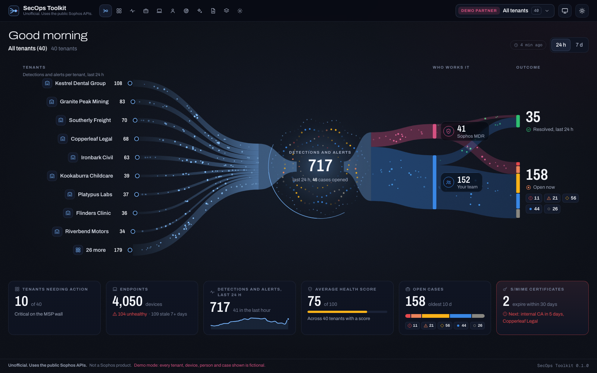

Every screenshot here uses the built-in demo data. The tenants, people, devices and cases in them are made up.

## Contents

- [Screens](#screens)
- [Requirements](#requirements)
- [Install and run](#install-and-run)
- [Add a Sophos API credential](#add-a-sophos-api-credential)
- [What it reads, and why it can't change anything](#what-it-reads-and-why-it-cant-change-anything)
- [Time zones and dates](#time-zones-and-dates)
- [Update](#update)
- [Settings](#settings)
- [Your data](#your-data)
- [Known limitations](#known-limitations)
- [Development](#development)
- [License](#license)

## Screens

| Screen | Shows |
| --- | --- |
| Overview | Where signals come from, how they became cases, who works them (Sophos MDR or your team) and how they ended |
| MSP wall | One tile per tenant, worst first, each with an AI Defense line (partner and organization credentials) |
| Now | Open cases by severity, unassigned cases, cases waiting on the customer, signals in the last hour, the case most over target, and feed freshness |
| Cases | Case SLA and ageing board: lanes by status, a paused clock while a case waits on the customer, the MDR auto-close countdown, and time to close |
| Endpoints | Stale and unhealthy devices, tamper protection off, agent drift, and a map of devices by public egress IP |
| Sign-ins | Where sign-ins come from, failures by reason, and sign-ins without MFA by app, OS, place and user (Fusion tenants) |
| Sources | Events per data source over 7 days, the last event from each, quiet and missing sources, and unparsed volume (Fusion tenants) |
| AI usage | What Sophos AI Defense saw in the last 7 days: AI apps and users flowing into blocked, warned or allowed, then apps and users by risk, the newest blocked and warned activity, policies and license |
| Reports | Eight reports to run, preview and export as PDF or CSV |
| Schema Atlas | Every Fusion and Data Lake field Sophos describes, searchable offline |

### Overview

Signals per tenant flow through a triage lens to who works the case and how it ended, with summary tiles underneath. It is the screenshot at the top of this page.

### MSP wall

One tile per tenant, sorted worst first. [MSP wall states](#msp-wall-states) explains what makes a tile critical or a warning.

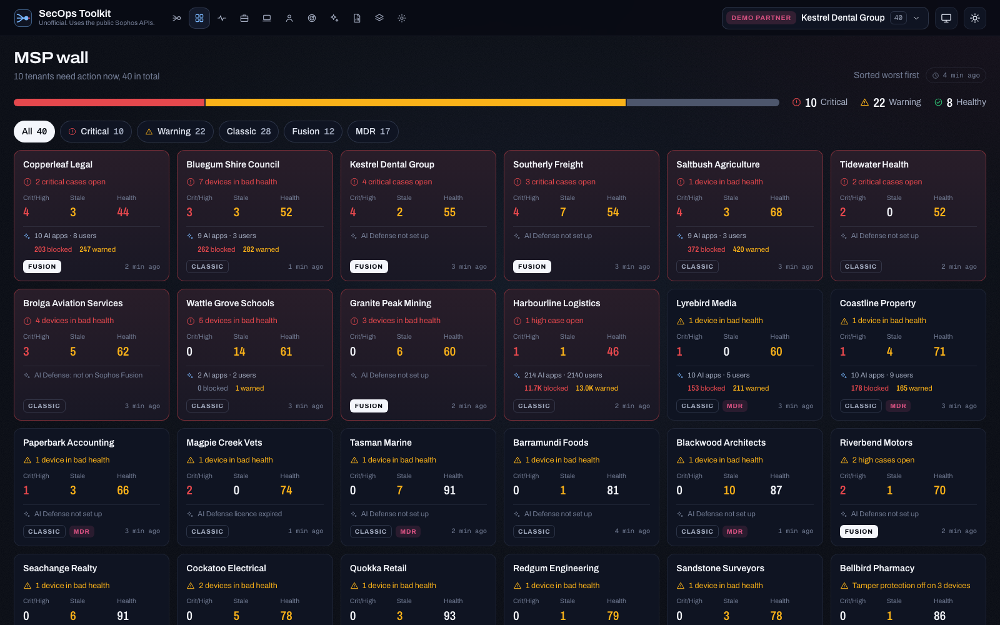

### Now

The live board for a SOC wall: open cases by severity, signals per hour for the last 24 hours, and the case furthest over its target.

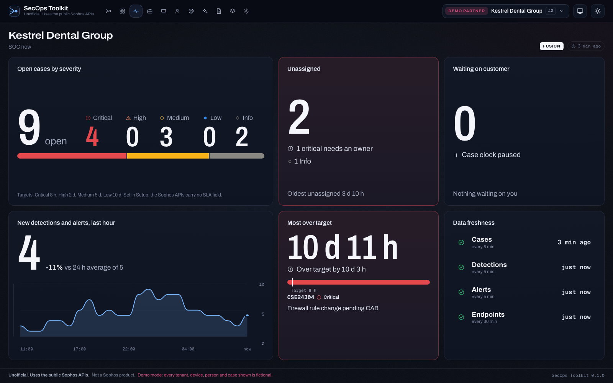

### Cases

Case ageing against the targets you set in Setup, with lanes by status.

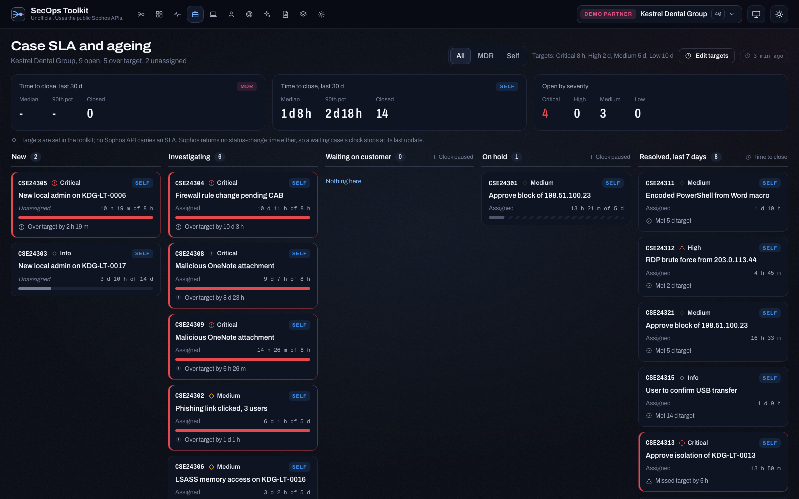

### Endpoints

Device health, staleness, tamper protection, agent versions, and a map of devices placed by their public egress IP.

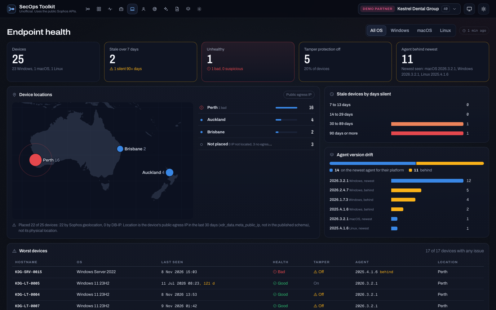

### Sign-ins

Sign-ins by place, failures by reason, and sign-ins without MFA. Needs a tenant on Sophos Fusion.

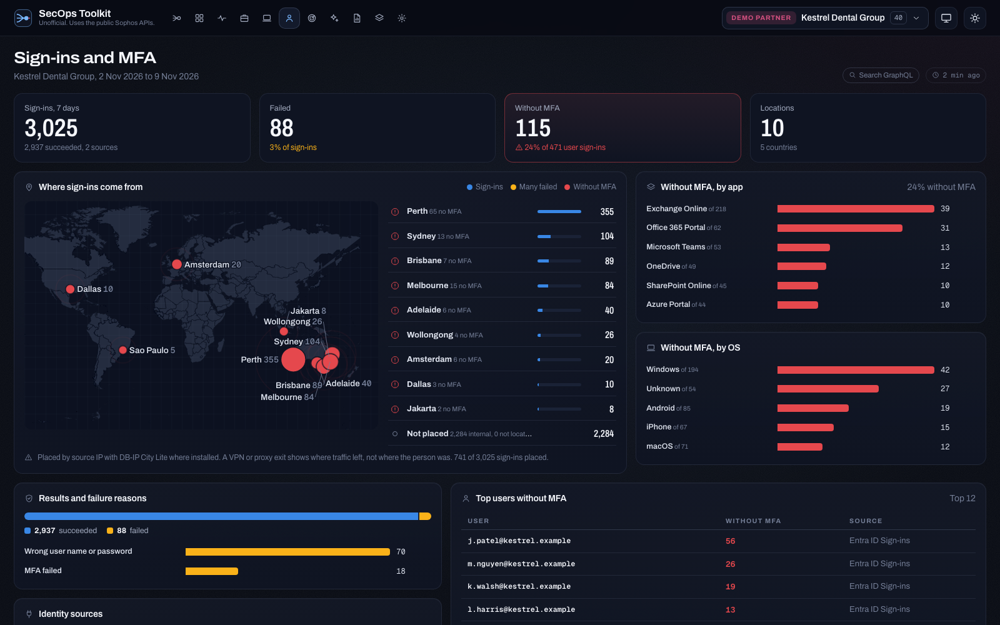

### Sources

Events per data source, the last event from each source, and the sources that went quiet. Needs a tenant on Sophos Fusion.

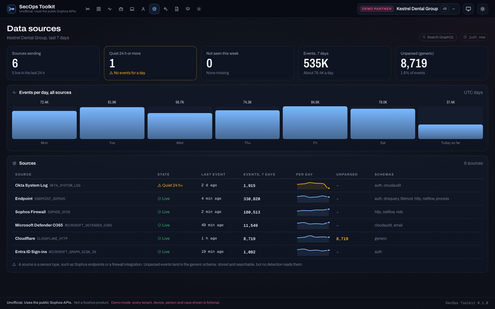

### AI usage

AI apps on one side and users on the other, both meeting at what AI Defense did with the activity. Needs AI Defense on the tenant.

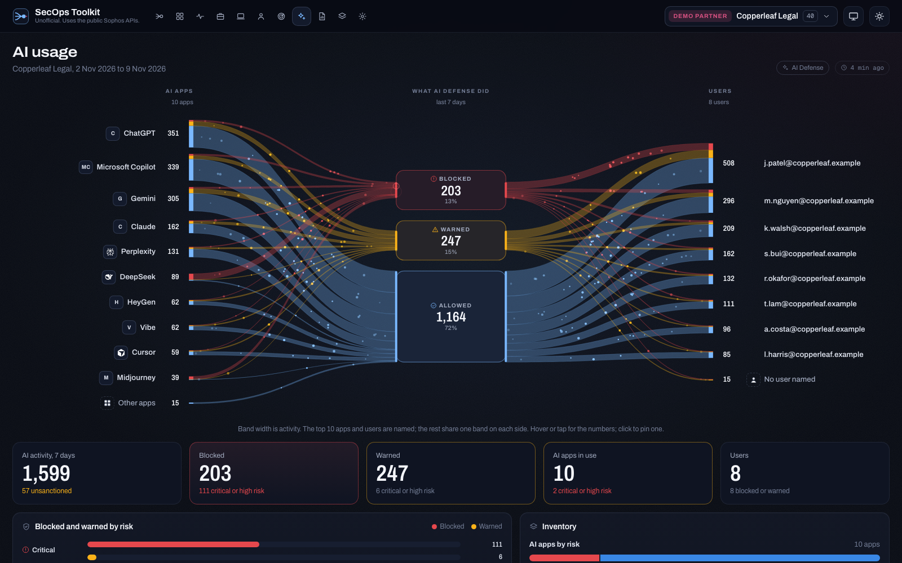

### Reports

Eight reports with a preview, a PDF export (A4 or US Letter) and CSV export of any table.

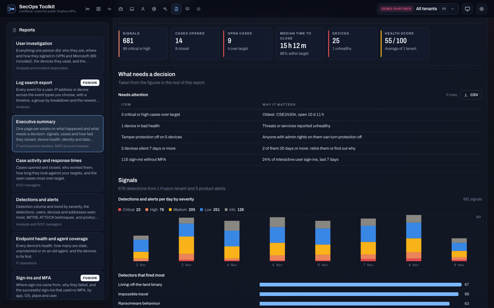

### Schema Atlas

Every Fusion and Data Lake field Sophos documents, searchable without a network connection.

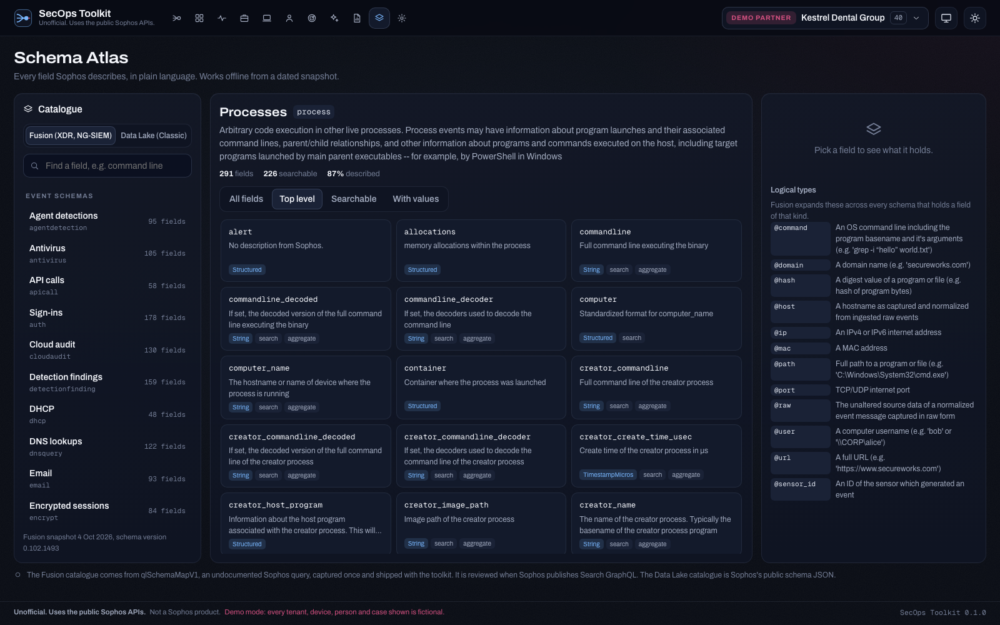

## Requirements

- [Node.js](https://nodejs.org) 22.13 or later. Node 24 LTS is recommended. npm comes with Node.
- [git](https://git-scm.com), to download and update the toolkit.
- Windows, macOS or Linux. CI tests every change on Ubuntu, Windows and macOS.
- A current Chrome, Edge, Firefox or Safari.
- A Sophos API credential. You can try every screen without one in demo mode.

## Install and run

The commands are the same in a macOS or Linux terminal and in Windows PowerShell or Command Prompt:

```sh
git clone https://github.com/Aaronjacobs000/sophos-secops-toolkit.git
cd sophos-secops-toolkit
npm install
npm start
```

`npm start` compiles the TypeScript and starts the server, so install with plain `npm install`: `npm install --omit=dev` leaves out the TypeScript compiler it needs. Open <http://127.0.0.1:3200> in your browser. Press Ctrl+C in the terminal to stop it.

To look around without a credential, press **Demo partner** or **Demo tenant** on the first screen, or start it with `npm run demo`. Demo mode makes no Sophos calls.

The toolkit listens on 127.0.0.1 only, so nothing else on your network can reach it. To change the port or open it to other machines, see [Settings](#settings).

## Add a Sophos API credential

The first screen asks for a client ID and client secret.

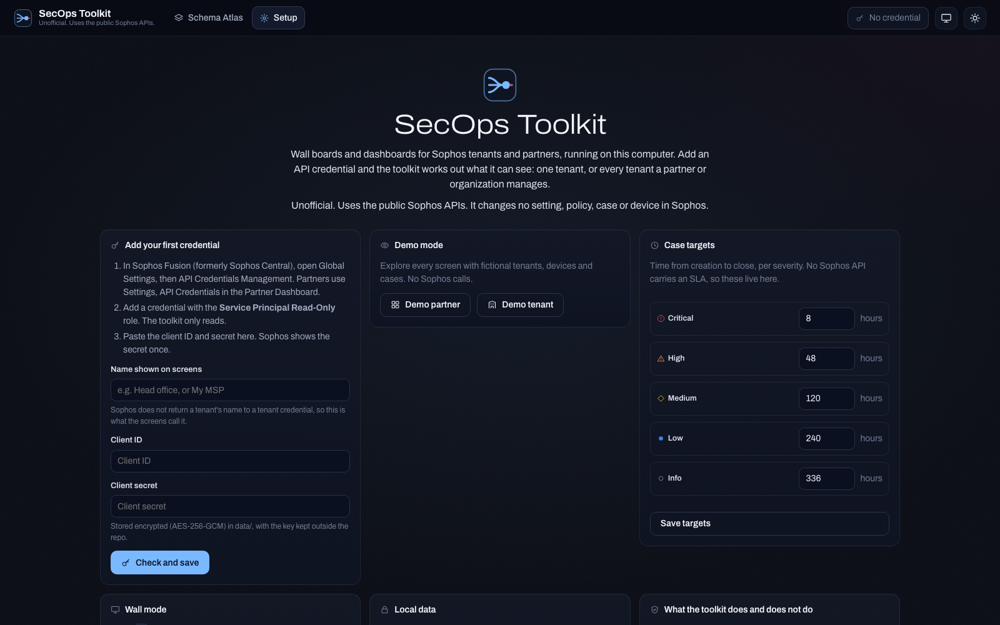

1. Create an API credential with the **Service Principal Read-Only** role, in the console that matches what you want to see:
   - One tenant: in Sophos Fusion (formerly Sophos Central), **Global Settings > API Credentials Management**.
   - Every tenant a partner manages: in the Sophos Partner Dashboard, **Settings > API Credentials**.
   - Every tenant in an organization: in the Enterprise Dashboard, **Global Settings > API Credentials Management**.
2. Copy the client secret straight away. Sophos shows it once.
3. Paste the client ID and secret into the toolkit and press **Check and save**.

The toolkit asks Sophos who the credential belongs to (`GET /whoami/v1`) and sets itself up to match:

- A **tenant** credential gets the single-tenant screens for that tenant.
- A **partner** or **organization** credential gets the MSP wall and a tenant picker on every other screen, including an "All tenants" view.

You can add more than one credential and switch between them in Setup. Setup also holds the case targets, the wall playlist, lobby privacy, the GeoIP download and the cache wipe.

Read-Only should be enough for the REST APIs, which the toolkit only calls with GET. It has not been tested against the newer APIs the toolkit reads: the Data Lake query (the egress map), Fusion GraphQL (Cases v2 and detections), Search GraphQL (Sign-ins and Sources) and the AI Defense reads (which need AI Defense read permission, and a separate one for policies). If a screen shows "No access (HTTP 403)", that call needs a broader role. A broader role does not let the toolkit change anything, because the guard described below refuses every write whatever the role allows.

## What it reads, and why it can't change anything

| API | Used for |
| --- | --- |
| `whoami`, partner and organization tenant lists | Working out what the credential can see |
| Endpoint API (`/endpoint/v1/endpoints`) | Device health, staleness, tamper protection and agent versions |
| Common API alerts (`/common/v1/alerts`) | Product alerts and integration alerts |
| Cases v2 (Fusion GraphQL) and cases v1 | Cases, case age and who works them |
| Detections (Fusion GraphQL) | Detections per tenant, severity, MITRE ATT&CK technique |
| Account health check | Health scores |
| Licensing API | Licenses and end dates |
| Data Lake query | Each device's latest public egress IP, for the map |
| Email S/MIME (internal CA and user certificates) | Certificates close to expiry |
| Search GraphQL | Sign-ins, MFA and data sources (Fusion tenants) |
| AI Defense activity and policy reads | The AI usage screen |
| Directory users | The user investigation report |

Every request passes a guard ([`backend/src/sophos/guard.ts`](backend/src/sophos/guard.ts)) before it leaves your computer. The guard allows:

- GET requests to Sophos API hosts.
- The OAuth token request.
- Data Lake query runs whose SQL starts with `SELECT` or `WITH`. The Data Lake query API only reads in any case.
- Fusion GraphQL queries on a fixed allowlist. The detection query the reports use and the four AI Defense reads are allowed only as their exact documents, character for character.
- Two Search GraphQL mutations, `CreateSearch` and `GetOrCreateSearch`, as their exact documents with a QL query as the only input. They start a search job, which Sophos runs and keeps for a while (30 days when tested). They change no setting, policy, case or device.

Everything else is refused, including every other GraphQL mutation, AI Defense's settings mutation and policy writes, and any host that is not a Sophos API host. The only other host the toolkit can reach is `download.db-ip.com`, and only when you press the GeoIP download in Setup. A redirect from a Sophos host is refused, so the client secret and the token never go to an address the guard has not checked. The vendored API client still contains write methods (device isolation, scans, case updates); the toolkit never calls them, and the guard would refuse them if it did. Tests check the guard.

Sophos enforces 100 calls a minute per credential and recommends no more than 1,000 an hour. The toolkit stays under 80 a minute and 900 an hour per credential, serves what is on screen first, and pauses the credential when Sophos answers 429. The budget meter in the header shows the last minute.

| Dataset | One tenant | Partner (per tenant) |
| --- | --- | --- |
| Cases, detections, alerts | 5 min | 5 to 10 min for the 8 worst tenants and any on screen, 60 min for the rest |
| Endpoints | 30 min | 2 h (30 min on screen) |
| Health check | 6 h | 6 h |
| Tenant list, licenses, API generation, egress IPs, S/MIME certificates | Daily | Daily |
| Sign-ins, MFA, data sources (Search GraphQL) | 15 min while on screen, else daily | 15 min for a tenant picked on screen, else daily |
| AI Defense | 15 min (hourly without AI Defense) | Hourly, 15 min for the 8 worst tenants and any on screen; daily for a tenant without AI Defense (hourly on screen) |

AI Defense costs one call for a tenant without it, three for a tenant with it, and four when anything was blocked or warned. A search costs at least three calls (start, a poll every 5 seconds, read), so the Search screens refresh quickly only for a tenant on screen, and no more than two searches run at once. Search windows end on a quarter hour and use `GetOrCreateSearch`, so a repeat within the same quarter hour reuses the search.

One install reads up to 150 tenants (`SECOPS_MAX_TENANTS`). On a 147-tenant partner the MSP wall tiles filled in about 12 minutes and every dataset in about 25 (roughly 820 calls). After that the steady state stays well under the hourly budget, and the budget carries over a restart.

### Reports

The Reports screen runs a report on one tenant or, where the report allows, all tenants, shows it, and exports it as a print-ready PDF (A4 or US Letter, with a cover and page numbers) or any table as CSV. A report reads through the same guard and rate limiter as the screens, at the front of the queue, and lists the calls it made.

| Report | Shows | Reads |
| --- | --- | --- |
| User investigation | A person's directory record, sign-ins by source, result, MFA and place, devices, accounts used, the detections and cases that name them, and activity by event type | Directory API, 5 Search GraphQL searches, Detections v2, Cases v2 title search (Fusion tenants; a Classic tenant gets the directory, devices and cases) |
| Log search export | Every event for a user, IP address or device across the event types chosen, as a timeline, a group-by and the newest 500 events | Search GraphQL: 2 searches, then one per four event types with events (Fusion tenants) |
| Executive summary | What needs a decision, signals, cases and time to close, device health, identity and data sources, AI Defense, and a per-tenant table for partners | The cache; 30 days on one tenant reads detections and alerts again |
| Case activity and response times | Cases opened and closed per day, time to close by severity and by who worked the case against your targets, open cases over target | The cache |
| Detections and alerts | Detections by severity, title, source, MITRE ATT&CK technique and tactic, the users, devices and addresses they name, and product alerts | Detections v2 for one tenant (one call), the cache for all tenants |
| Endpoint health and agent coverage | Health, staleness, tamper protection, agent versions, the devices to fix first, health check and licenses | The cache |
| Sign-ins and MFA, Data source health | The Sign-ins and Sources screens as reports | The cache |

`scripts/report.mjs` runs any report on demo data with no server and writes its PDF and CSV files (see [Development](#development)).

### Wall mode

Press **W** (or the screen button in the header) for full-screen boards that rotate every two minutes. The arrow keys skip a board and Esc leaves. On a signage box, open `http://localhost:3200/?wall=1` in a kiosk browser (`chromium --kiosk`). Use `localhost` rather than a LAN address: browsers only keep the screen awake (Wake Lock) in a secure context. Setup sets the playlist, the seconds per board, and a lobby privacy mode that hides tenant names, hostnames and case titles.

### MSP wall states

A tenant is **critical** with an open critical case, three or more high cases, three devices in bad health (or a tenth of 10 or more), tamper protection off on a quarter of its devices (three or more), a health score under 50, or a license, S/MIME internal CA or S/MIME user certificate ending within 7 days. Smaller versions of the same make it a **warning**: one or two high cases, any device in bad health, tamper protection off on 5% or five devices, a tenth of devices stale (or 25), health under 70, a license or S/MIME certificate ending within 30 days, or an integration alert in the last 24 hours. A certificate that has already expired is listed but does not color the tile. Everything else is **healthy**. The AI Defense line on a tile does not change its state.

### Device map

No Sophos API returns a device's location. The map places each device by its latest public egress IP from the Data Lake (`xdr_data.meta_public_ip`, which answers but is not in the published schema), using Sophos's own IP geolocation (`xdr_ioc_view`) where it exists. **Setup > Download DB-IP** adds the free DB-IP City Lite database (CC BY 4.0, about 60 MB) for the rest. Egress is where traffic leaves the network, not where the device is: an office lands on one point and VPN users on their VPN exit. The map needs one tenant selected.

## Time zones and dates

Every screen shows times in the time zone of the browser you view it in. A report run from the browser uses that browser's time zone too, and names it on the PDF cover and in the headers of the CSV time columns. Two people in different time zones looking at the same toolkit each see their own local time.

A report run without a browser (`scripts/report.mjs`) uses the computer's time zone, or the one passed with `--tz`. Set `TZ` (for example `TZ=America/Chicago` in `.env`) to change the computer's default for the toolkit.

Dates print with the month as a word, such as "9 Nov 2026", so nobody reads 03/11 as 11 March or the other way round. The clock is 24-hour. A calendar date that Sophos sends without a time, such as a license end date, shows as that date everywhere.

The daily charts built from Search GraphQL (events per day on the Sources screen and in the log search and user reports) use UTC days, because Sophos counts them by UTC day. Those charts say so.

## Update

Stop the toolkit, then in its folder:

```sh
git pull
npm install
npm start
```

Your credentials, cache and settings stay in `data/` and in the key folder, which git does not touch.

## Settings

Set these in a `.env` file in the toolkit folder (one `NAME=value` per line) or in the shell before `npm start`.

| Variable | Default | Meaning |
| --- | --- | --- |
| `PORT` | 3200 | Port to listen on |
| `HOST` | 127.0.0.1 | Listen address. `0.0.0.0` opens it to the network; set `ALLOWED_IPS` too |
| `ALLOWED_IPS` | | Clients allowed when `HOST` is not loopback (addresses and CIDR subnets) |
| `ALLOWED_HOSTS` | | Extra host names accepted, for a reverse proxy. Other names are refused, which blocks DNS rebinding |
| `SECOPS_DATA_DIR` | `./data` | Credentials, cache and settings |
| `SECOPS_KEY_DIR` | `~/.secops-toolkit` | Encryption keys |
| `SECOPS_MAX_TENANTS` | 150 | Tenants read per install |
| `SECOPS_EXCLUDE_TENANTS` | | Tenant IDs or ID prefixes to skip, comma-separated |
| `SECOPS_RATE_PER_MIN`, `SECOPS_RATE_PER_HOUR` | 80, 900 | Per-credential call budget (the minute value is capped at 100) |
| `SECOPS_CACHE_DAYS` | 30 | Days the cache keeps data |
| `SECOPS_DEMO` | | `1` forces demo mode |
| `TZ` | The computer's | Time zone for reports run without a browser |

If you open the toolkit to other machines, put HTTPS in front of it (a reverse proxy or Tailscale Serve) and set `ALLOWED_IPS` and `ALLOWED_HOSTS`. The toolkit has no login of its own: anyone who can reach the port can see the cached tenant data.

## Your data

- Credentials are kept in `data/credentials.json`, encrypted with AES-256-GCM. The key is in `~/.secops-toolkit/`, outside the toolkit folder, so copying `data/` exposes nothing.
- The cache is `data/cache.db`. Every row is encrypted, and rows are kept 30 days (`SECOPS_CACHE_DAYS`). **Setup > Wipe cache** deletes every row and replaces the key.
- The cache holds tenant data on your computer, outside the tenant's Sophos data region. Decide whether that suits each customer before you add a partner credential.
- The page loads nothing from the internet. Fonts, the world map and every chart are bundled.

## Known limitations

- No API carries a case SLA, due date or status-change time. You set targets in Setup, and a waiting case's clock stops at its last update.
- Sophos returns no overall health score. The toolkit shows the average of the health check sections.
- Classic (not yet migrated) tenants have no Fusion detections; their signals are Sophos alerts. Classic resolved cases are those created in the last 30 days.
- Search GraphQL serves the Sign-ins and Sources screens on Fusion tenants only. A Classic tenant shows why the screen is empty, and the two screens leave the menu once every tenant is known to be Classic.
- One search covers at most 31 days (the API refuses more), so these screens show the last 7 days and 13-month trends are not possible.
- Only identity sources fill the MFA fields. Microsoft Entra ID sign-ins do; Sophos endpoint logons always report no MFA, so they are listed but never counted as sign-ins without MFA. Only interactive user sign-ins are counted. Service principal and non-interactive sign-ins are listed separately.
- The sign-in map places public source IPs with DB-IP City Lite (Setup). Private and internal addresses are counted but not placed.
- AI Defense counts cover the last 7 days. One AI Defense activity can gather several related events. The API has no count of which person used which app, so the AI usage flow shows apps and users each against the outcome, not apps against people.
- PDFs print Latin text in Helvetica, which every PDF reader has, and Chinese, Japanese, Korean, Thai, Cyrillic, Greek, Arabic and Hebrew text in bundled Noto fonts, embedded with only the characters the report uses. Other scripts (Devanagari, Tamil, Khmer and the like), emoji and CJK ideographs outside the main Unicode block (Extension A and beyond) still print as "?". Japanese kanji take the Simplified Chinese letterforms, and bold Chinese, Japanese or Korean is the regular weight drawn heavier. Copying Arabic out of a PDF is exact in Chrome, Edge and Acrobat; other viewers can drop or change a letter. The CSV export keeps every character.
- The Read-Only role has not been tested against the newer APIs listed under [Add a Sophos API credential](#add-a-sophos-api-credential).
- Two calls are undocumented and may change without notice: `qlSchemaMapV1` (Fusion GraphQL), which built the Schema Atlas snapshot once (the app never calls it), and `tenant { centralTenant { xdrOwnership } }`, which decides whether a tenant's cases are on Fusion (Cases v2) or Classic (cases v1). If the second fails, the toolkit tries v2 and then v1.

## Development

```sh
npm test              # compiles, then runs the unit tests (node:test)
npm run build         # compiles only
node scripts/report.mjs --list                                        # the reports, after npm run build
node scripts/report.mjs --report executive --tenant all --out ./out   # a demo report's PDF and CSVs
npm run atlas -- <qlSchemaMapV1.json> [legacy-schema-dir]             # rebuild the Atlas snapshot
npm run fonts                                                         # rebuild backend/fonts from the pinned Noto sources
```

The backend is TypeScript on Express in `backend/src`. The frontend is plain HTML, CSS and ES modules with no build step, in `frontend/`.

## License

MIT, see [`LICENSE`](LICENSE). The vendored `@notfusion/sophos-core` is Apache-2.0 AND MIT; see [`NOTICE`](NOTICE) and [`ATTRIBUTIONS.md`](ATTRIBUTIONS.md), which also credit the bundled fonts, map data and the AI app logos from [Simple Icons](https://simpleicons.org) (CC0-1.0, each mark a trademark of its owner).

Sophos, Sophos Central and Sophos Fusion are trademarks of Sophos Limited. This project is not affiliated with, endorsed by or supported by Sophos. See [`TRADEMARKS.md`](TRADEMARKS.md).
